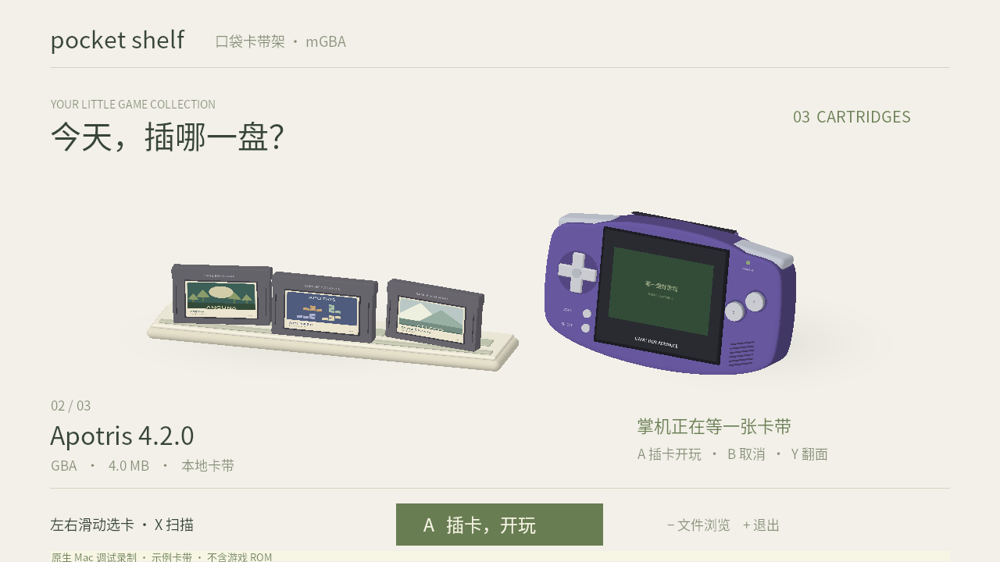
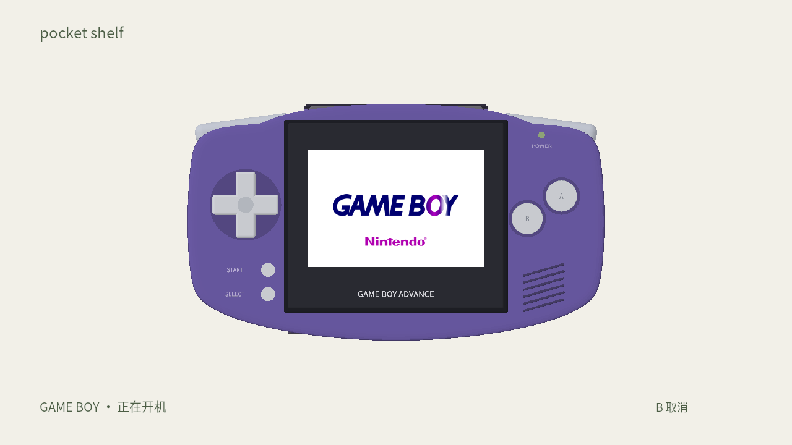

<div align="center">


**把游戏列表，变成一座可以亲手插卡的卡带架。**

A native cartridge shelf for mGBA on Nintendo Switch.

[](https://github.com/realzhengyiming/mgba-pocket-shelf/actions/workflows/pocket-shelf.yml)
[](contrib/pocket-shelf/SWITCH_TEST.md)
[](LICENSE)
[](#当前状态)

[效果预览](#效果预览) · [安装到 Switch](#安装到-switch) · [本地预览与开发](contrib/pocket-shelf/README.md) · [原版 mGBA](README.upstream.md)

</div>

## 效果预览


<p align="center"><b>选一盘 → 从机背插入 → 转回正面 → 开机 → 放回架子</b></p>

<p align="center"><sub>实际 C/OpenGL 渲染 · Mac 调试版 · 约 13 秒循环 · GIF 无声。演示使用示例卡带元数据，中间的游戏运行段未展示。不是 Switch 实机录像。</sub></p>

<table>
  <tr>
    <td width="50%"></td>
    <td width="50%"></td>
  </tr>
  <tr>
    <td align="center"><b>一座小小的游戏收藏架</b><br /><sub>左右选卡，显示名称、容量与卡带标签。</sub></td>
    <td align="center"><b>把开机也变成一次小仪式</b><br /><sub>掌机居中，彩色字母入场，再交给 mGBA。</sub></td>
  </tr>
</table>

## 可以做什么

- **浏览自己的游戏**：递归扫描 `/roms`，支持 GBA、GB 和 GBC 等卡带格式。
- **用手指或手柄选卡**：左右滑动跟手浏览，松手吸附；也可用十字键或摇杆。
- **模拟插入短 GBA 卡带**：从掌机背面卡槽插入，转回正面，播放开机效果。
- **随时放回**：按 B 取消插卡；从 mGBA 退出游戏后返回卡带架。
- **让卡带有自己的封面**：读取同名 PNG，或按 GBA 游戏编号读取本地图片缓存。
- **沿用 mGBA**：继续使用它的模拟核心、按键设置、存档与暂停菜单；支持减少动画。

> 基于 [mGBA](https://github.com/mgba-emu/mgba) 的非官方分支。Switch 运行的是 C/OpenGL ES 原生前端；网页版本用于交互预览。仓库和安装包都不附带游戏 ROM。

## 安装到 Switch

需要已能运行自制软件的 Switch，以及自己的游戏文件。

1. 在 [Pocket Shelf checks](https://github.com/realzhengyiming/mgba-pocket-shelf/actions/workflows/pocket-shelf.yml) 中选择最近一次通过的运行，下载 **`mgba-pocket-shelf-switch`** 构建产物。GitHub 下载构建产物通常需要登录；也可[自行编译](contrib/pocket-shelf/README.md#switch-build-and-sd-package)。
2. 解压后，把 `SD卡文件/switch/mgba-pocket-shelf` 复制到 SD 卡的 `/switch/`。
3. 游戏放在 `/roms` 或其子目录。原来的 mGBA 入口可继续保留。
4. **按住 R 打开一个已安装游戏**，进入完整内存模式的 hbmenu，选择 **mGBA Pocket Shelf**。

```text
SD 卡/
├── switch/
│   ├── mgba/                          # 原来的入口可以保留
│   └── mgba-pocket-shelf/
│       └── mgba-pocket-shelf.nro
└── roms/
    └── GBA/
        ├── My Game.gba                # 自己的游戏
        └── My Game.png                # 可选：同名封面
```

完整安装说明、存档路径、触摸操作及故障排查见 **[Switch 使用说明](contrib/pocket-shelf/SWITCH_TEST.md)**。请保留安装包里的许可证与 `BUILD-INFO.json`。

### 常用操作

| 操作 | 卡带架中的功能 |
| --- | --- |
| 左右滑动 / 十字键 / 左摇杆 | 浏览卡带 |
| A | 插卡、播放开机效果、启动游戏 |
| B | 取消插卡并放回 |
| X / Y | 重新扫描 / 查看机背 |
| ZR | 开关减少动画 |
| − / ＋ | 原版文件浏览器 / 退出卡带架 |

**游戏内**沿用 mGBA 的映射：默认 X 打开暂停菜单，选择 **Exit game** 返回卡带架。自定义过按键时，以现有配置为准。

## 封面怎么放

原生版优先查找与 ROM **同名的 PNG**，其次读取 `covers/游戏名.png`。GBA 还可以按校验有效的四位游戏编号读取缓存，例如 `roms/GBA/covers/BPEE.png`。

GBA ROM 通常没有标准封面图片字段，图片需要另行准备。改版可能共用编号，此时使用同名 PNG 覆盖即可；没有图片时会生成文字标签。Switch 原生版目前不支持 JPEG 或自动联网下载封面。

## 当前状态

| 项目 | 已验证的范围 |
| --- | --- |
| Switch 原生卡带架 | 已交叉编译；首轮实机已确认能够显示卡带架 |
| Mac 原生调试版 | GPU 渲染、真实 ROM 启动/返回及自动检查已通过 |
| 新增居中开场与合成提示音 | 已集成；Switch 实机验收仍在进行 |
| 睡眠恢复、底座切换、存档连续性 | 仍需逐项验收 |
| 网页原型 | 可预览、拖卡与换色；不启动模拟器 |

这是测试版本。开机画面和音效是参考原机录像制作的近似复刻，不是原 BIOS，也不宣称逐帧或声音完全一致。

## 想在电脑上先看看？

```sh
cd contrib/pocket-shelf/preview
npm ci
npm run dev
```

打开终端输出的本地地址，默认是 `http://127.0.0.1:3764`。没有 ROM 时会显示设计示例卡带，可以直接体验交互。

| 继续了解 | 链接 |
| --- | --- |
| 原生 Mac 调试、Switch 编译、测试命令 | [开发说明](contrib/pocket-shelf/README.md) |
| 前端如何接入 mGBA | [架构说明](contrib/pocket-shelf/ARCHITECTURE.md) |
| 掌机与短卡带的造型参考 | [硬件参考](contrib/pocket-shelf/HARDWARE_REFERENCES.md) |
| README 图片、GIF 来源与重新录制 | [演示素材说明](contrib/pocket-shelf/docs/MEDIA.md) |
| mGBA 核心的功能、平台与编译说明 | [原项目 README](README.upstream.md) |

## 致谢与许可证

感谢 **Jeffrey Pfau 与 mGBA contributors** 提供模拟核心，以及 devkitPro、libnx、Three.js、FreeType 和 Noto Sans SC 等项目。

mGBA 和本分支新增源码保留 **[MPL-2.0](LICENSE)**；字体与其他依赖采用各自许可证，完整归属见 **[NOTICE](contrib/pocket-shelf/NOTICE.md)**。界面模型和示例卡带标签由本项目制作；Game Boy/Nintendo 字标的来源及商标说明见 NOTICE。本项目与 Nintendo、mGBA 官方均无隶属或背书关系。

本分支包含 AI 辅助开发，改动仅维护在此 fork，不向禁止此类提交的上游发送 PR。
