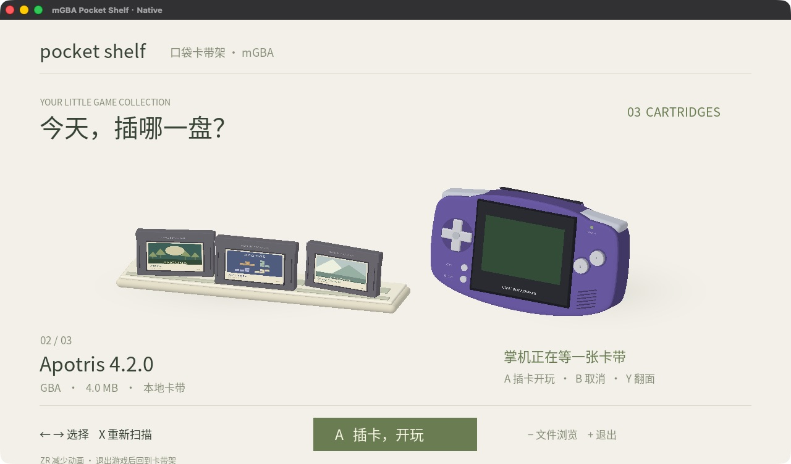
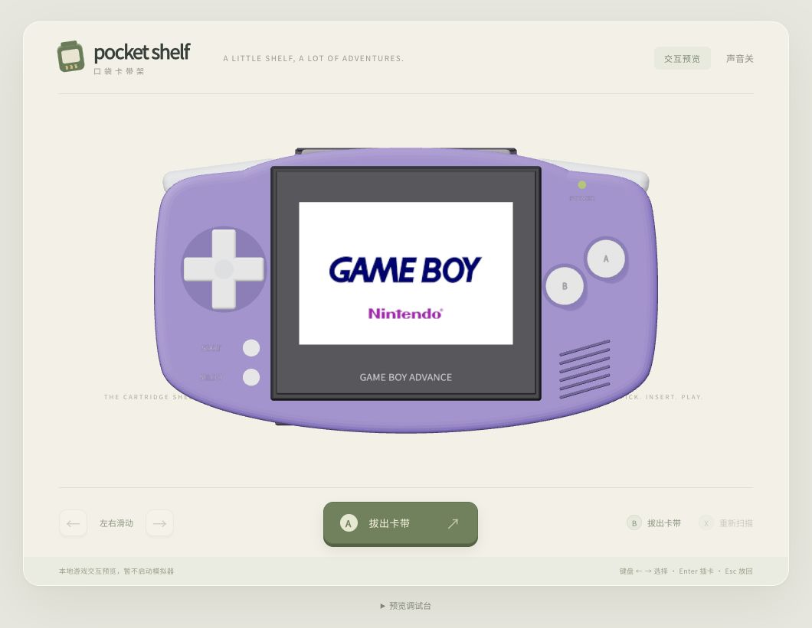

# Pocket Shelf / 口袋卡带架

A cartridge-style frontend for this mGBA fork: browse your ROM folder, choose a short GBA cartridge, insert it into the back of an AGB-001-style handheld, then launch the game.



## Current status / 当前状态

**The C/OpenGL ES frontend is integrated into the Switch version. An initial Switch test confirmed the native shelf displays correctly; broader hardware acceptance checks continue.**

- The shared native C layer scans ROM folders recursively, preserves actual filenames and reads same-name PNG covers, then validated GBA header IDs such as `covers/BPEE.png`. Missing covers get an original generated label.
- Horizontal touch/mouse swipes track the finger, snap with a short fling, and stay bounded at the ends. Taps and vertical/cancelled gestures are kept separate from game launch.
- Native models reuse the [AGB-001 / short GBA cartridge design](HARDWARE_REFERENCES.md), with rear insertion, a centered handheld boot presentation, cancellation, smooth ejection and reduced motion.
- Selecting a game centers the handheld, inserts the pak, runs the shared 3.9-second visual boot recreation, then fades into mGBA. Ejection shrinks the handheld before lifting the pak and smoothly returns it; B can cancel throughout. The synthesized startup flourish/bell is an approximation.
- Switch reuses the original mGBA game loader, controls, audio, saves and pause menu. Exiting a game returns to the shelf. Minus opens the original file picker.
- CJK font rendering, nearby-cover caching and GPU teardown before emulation are implemented.
- The desktop debugger uses the same renderer/state machine and launches the SDL emulator. Actual Mac launch/return and a 240-frame ROM smoke test passed.
- CI builds desktop and Switch targets. The package script checks the actual NRO's identity and embedded assets before producing the SD layout and checksum.

原生版已经接入，并已在 Switch 上成功显示卡带架。当前仍是测试版；音频、按键、睡眠恢复、底座切换和存档连续性继续逐项验收。原生版暂未移植网页的自由拖拽和换色；开场和合成提示音已接入；封面支持同名 PNG 或按 GBA 编号读取本地缓存，JPEG 和自动联网下载尚未接入。

[安装和今晚测试步骤](SWITCH_TEST.md) · [Architecture / integration details](ARCHITECTURE.md)

## Boot presentation and covers

The handheld centers before cartridge pickup, faces rearward for insertion, turns forward and plays a 3.9-second visual boot reconstruction. The rainbow letter entrances, blue settling and magenta highlight reference [this GBA startup recording](https://www.youtube.com/watch?v=6_ZD3FxMcvQ). This is a visual approximation, not BIOS execution or a frame-exact/sound-exact replacement. The original Game Boy wordmark replaces the earlier illustrative pixel font. The website retains the final logo as a preview; native Switch waits for the full presentation and white fade before handing the ROM to mGBA. B cancels throughout. Ejection takes two seconds, with a fixed canvas/viewport and continuous cartridge scale at the return boundary.

Standard GBA ROM headers contain title/game-code fields, not a standard box-art image. Put a PNG beside a ROM with the same basename for a manual override, or cache an image at `roms/GBA/covers/BPEE.png` for games whose validated header code is BPEE. The browser and native catalogue use the same priority. Hacks may reuse a base game's code, so use the per-ROM override when artwork differs. No online scraping happens on Switch; missing images keep the generated label. User ROMs, downloaded commercial artwork and saves are not included in this repository.



## Native desktop debugging

macOS requirements: Xcode command-line tools, CMake 3.21+, SDL2, FreeType, libpng and pkg-config. The Mac debug target currently requires macOS 15+ because its Homebrew dependencies are built for that minimum version.

```sh
brew install cmake sdl2 freetype libpng pkg-config
cmake --preset pocket-macos-debug
cmake --build --preset pocket-macos-debug --parallel 4
./build-pocket-macos/pocket-shelf/mgba-pocket-shelf --roms /absolute/path/to/roms
```

Run from the repository root. Swipe the shelf or use left/right to select; release to snap. Enter/A inserts, Esc/B cancels, Y inspects the rear, X rescans, R toggles reduced motion and Q exits. The Mac adapter launches the existing SDL executable via `posix_spawn`; Switch uses the in-process `mGUIRunner` hook. This debug `.app` is tied to the build directory and dependencies; it is not a portable Mac release.

```sh
./build-pocket-macos/pocket-shelf/pocket-shelf-tests
./build-pocket-macos/pocket-shelf/mgba-pocket-shelf --roms /absolute/path/to/roms --self-test-rom /absolute/path/to/roms/game.gba
```

The second command renders the actual native UI, inserts a cartridge, runs that ROM for 240 frames without writing a save, recreates the renderer and returns the cartridge. Add `--screenshots /existing/output/dir` for checkpoints. No ROM is bundled in this repository.

## Switch build and SD package

With the official devkitPro Switch toolchain and portlibs installed:

```sh
cmake --preset pocket-switch
cmake --build --preset pocket-switch --parallel 4
python3 contrib/pocket-shelf/tools/package-switch.py build-pocket-switch/switch/mgba.nro dist/pocket-shelf
```

The CI container is pinned to the verified `devkitpro/devkita64:20260219` manifest digest recorded in the workflow and package build information. It includes libnx 4.12.0 and the linked port libraries. Models, the CJK font and licenses are embedded in RomFS. The package installs to `/switch/mgba-pocket-shelf/mgba-pocket-shelf.nro`, alongside the existing mGBA.

## Browser design reference / 网页原型

```sh
cd contrib/pocket-shelf/preview
npm ci
npm run dev
```

Open <http://127.0.0.1:3764>. The web prototype supports horizontal shelf swipes, upward cartridge pickup/dragging, optional sound, shell colors, rear inspection, and GLB/motion export. It **does not launch games**; the native program above does.

Default ROM folder: `contrib/pocket-shelf/roms`. Override with `POCKET_ROMS=/absolute/path/to/roms npm run dev`. Without game files, the web preview displays clearly marked design-only sample cards. Use `POCKET_DEMO=0` for an empty shelf. Same-name web covers may be PNG/JPEG; native covers are PNG. For GBA, an intact cartridge header can identify a four-character game code. Put a cached PNG at `roms/GBA/covers/BPEE.png` to cover translated Emerald filenames sharing that code. A same-name cover takes priority, so ROM hacks can override reused codes. No network request is made from the Switch; arbitrary ROMs do not contain a standardized cover image.

The boot presentation is a recreation based on hardware footage, not an official BIOS animation or a claim of frame/audio-identical output; [sources and asset attribution](NOTICE.md#boot-presentation) are recorded. The 480×320 logo mask is shared between browser and native targets. Build-time generators require Pillow/CairoSVG; generated assets are checked in, so those tools are not runtime dependencies.

The browser server listens on loopback only, omits absolute paths from its catalogue and never serves ROM bytes. Model and motion exports are design assets; JavaScript/DOM code is not embedded in the native program.

## Checks

```sh
cd contrib/pocket-shelf/preview
npm test
```

The browser tests cover safe catalogue scanning, filename preservation, duplicate identities, animation lifecycle, reduced motion and the serving boundary. Native tests cover catalogue/cover handling, symlink loops, cancellation continuity, safe insertion/ejection and reduced motion. Mac native state tests also passed AddressSanitizer/UndefinedBehaviorSanitizer.

## License and upstream

Original mGBA attribution and MPL-2.0 are retained. Pocket Shelf source, baked geometry and original illustrative labels are MPL-2.0. Third-party notices are in [NOTICE.md](NOTICE.md) and `licenses`; the bundled Noto Sans SC font is SIL OFL.

This fork contains AI-assisted development. Upstream's policy does not accept AI-generated pull requests; these changes remain in this fork and are not submitted upstream. No game ROMs, user saves, credentials or private machine configuration are included.
